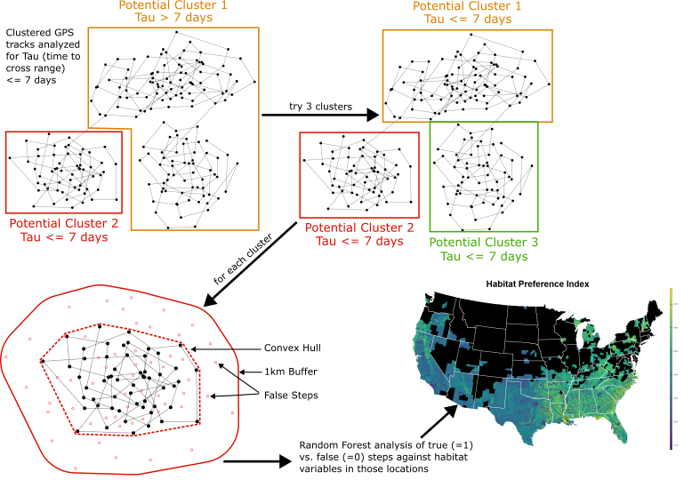

# asfra_habpref

Takes input data and GPS collar data and determines habitat preference from step selection function adapted to pig social dynamics.

Changes to typical SSF analysis demonstrated in the following diagram: 

Data and model defninitions are not included in this repo, contact eric.sodja@usda.net for access.
